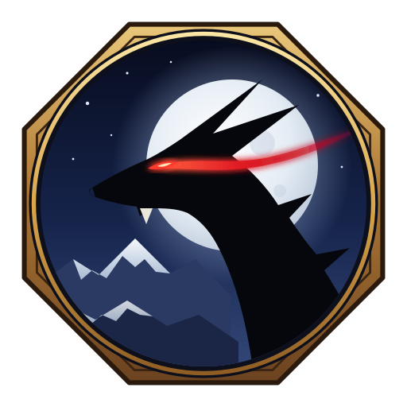

<p align="center"><b>English</b> · <a href="README.ru.md">Русский</a> · <a href="README.es.md">Español</a></p>

<p align="center"></p>

<h1 align="center">Pokee</h1>

<p align="center"><b>Monster Hunter Freedom Unite, running natively on your PC.</b></p>

<p align="center">
  <a href="https://github.com/LocalBBQ/Pokee/releases/latest"><b>Download for Windows</b></a> ·
  <a href="docs/LINUX.md">Linux / Steam Deck</a> ·
  <a href="docs/MACOS.md">macOS</a> ·
  <a href="docs/BUILDING.md">Build from source</a>
</p>

> Pokee does not include the game. You need your own disc image of *Monster Hunter Freedom Unite* (USA, `ULUS-10391`, v1.01).

## Install on Windows

1. Download the zip from [Releases](https://github.com/LocalBBQ/Pokee/releases/latest) and extract it, for example to `C:\Games\Pokee` (not `Program Files`).
2. Add that folder to Windows Defender's exclusions. Defender scans all 290 of Pokee's DLLs on every start, which can make startup take minutes. In an administrator PowerShell:
   ```powershell
   Add-MpPreference -ExclusionPath "C:\Games\Pokee"
   ```
3. Run `Pokee.exe` and pick your `.iso`.

Press **Esc** or **L3 + R3** for Pokee's menu.

## Features

| | |
| --- | --- |
| **[Item Sets](profiles/mhfu/README.md#item-sets)** | Save your pouch and load it back from the item box |
| **[Damage numbers](profiles/mhfu/README.md#damage-numbers)** | Every hit's damage where it lands, shared online |
| **[Eat in the Guild Hall](profiles/mhfu/README.md#eating-in-the-guild-hall)** | Order food from any hall table |
| **Change equipment online** | Swap gear from the Guild Hall item box |
| **[UI scaling](profiles/mhfu/README.md#ui-scaling)** | Size the map, status, items and names separately |
| **[Modern sharpness gauge](profiles/mhfu/README.md#modern-sharpness-gauge)** | Sharpness that visibly runs down |
| **[Fast item selection](profiles/mhfu/README.md#item-left-and-right)** | Scroll items with one button, plus an [empty slot](profiles/mhfu/README.md#empty-item-slot) |
| **[Gather icons](profiles/mhfu/README.md#gather-icon)** | See what a point gives; hold to keep gathering |
| **True Attack Value** | Real weapon numbers on the equipment screens |
| **[Key quests](profiles/mhfu/README.md#key-quests)** | Marked in the quest lists |
| **Graphics** | Widescreen, up to 6× resolution, 60+ fps, field of view, [HD texture packs](profiles/mhfu/README.md#hd-texture-packs) |
| **[Multiplayer](profiles/mhfu/README.md#multiplayer-ad-hoc)** | Ad hoc play over LAN or the internet |

All settings and controls: [profile README](profiles/mhfu/README.md). How it works: [ARCHITECTURE.md](docs/ARCHITECTURE.md). Problems: [issues](https://github.com/LocalBBQ/Pokee/issues).

<details>
<summary><b>Credits</b></summary>

Built from [Yakumo](https://github.com/TeamGDB/Yakumo), the Portable 3rd port by [@MHunterG](https://github.com/MHunterG), [@mojitosunrise](https://github.com/mojitosunrise) and contributors, on the [PSPRecomp](https://github.com/jessicanataliagta/PSPRecomp) framework.

Uses [SDL3](https://www.libsdl.org/), [FFmpeg](https://ffmpeg.org/), [Vulkan](https://www.vulkan.org/), [MoltenVK](https://github.com/KhronosGroup/MoltenVK), [Dear ImGui](https://github.com/ocornut/imgui), [tiny-AES-c](https://github.com/kokke/tiny-AES-c) and [stb_truetype](https://github.com/nothings/stb); archive format documentation from [svanheulen/mhef](https://github.com/svanheulen/mhef); logo lettering in [Cinzel](https://github.com/NDISCOVER/Cinzel) and [Shippori Mincho](https://github.com/fontdasu/ShipporiMincho) (SIL Open Font License).

</details>

<details>
<summary><b>Legal disclaimer</b></summary>

**Pokee** is an independent, open-source project and is not affiliated with, authorized by, sponsored by, or endorsed by CAPCOM, Sony, or any of their affiliates.

Monster Hunter, Monster Hunter Freedom Unite, CAPCOM, PlayStation, PSP, and all related trademarks, game assets, artwork, audio, characters, and other intellectual property belong to their respective owners.

**Pokee** does not include any game assets or original game files: no disc image, no copy of the game's executable or data, and no textures, models, audio or video from the game. You must provide the files from your own legally obtained copy of Monster Hunter Freedom Unite (USA) to install or build **Pokee**; the installer checks that copy and accepts only `ULUS-10391` version 1.01.

Users are solely responsible for obtaining, dumping, extracting, and using their game copy in accordance with the laws applicable in their jurisdiction.

**Pokee** does not support, provide, link to, or encourage the use of unauthorized or pirated copies of the game.

Any references to the original game or its trademarks are made solely for identification, compatibility, and interoperability purposes.

Screenshots and other depictions of the original game may be used solely to document or demonstrate **Pokee's** functionality. All depicted third-party game content remains the property of its respective rights holders.

The license covering **Pokee** applies only to the project's own original code and materials and does not grant any rights to third-party intellectual property.

</details>

MIT License; see [LICENSE](LICENSE) and [SOURCE_PROVENANCE.md](docs/SOURCE_PROVENANCE.md) for third-party notices.
