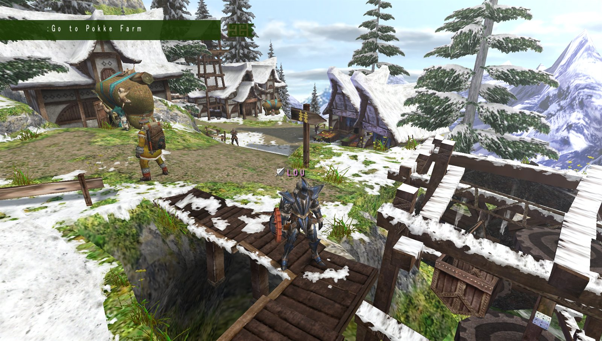
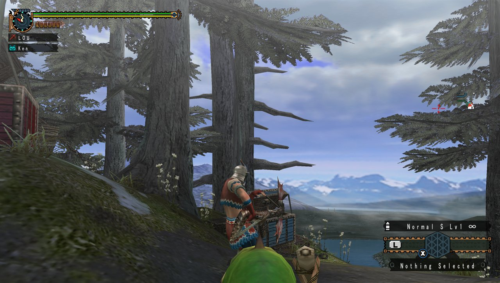
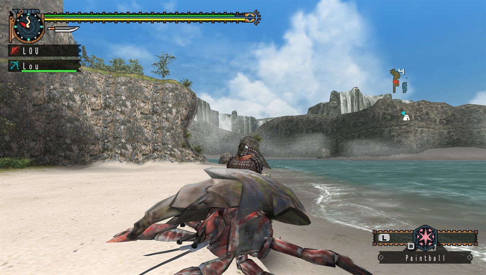
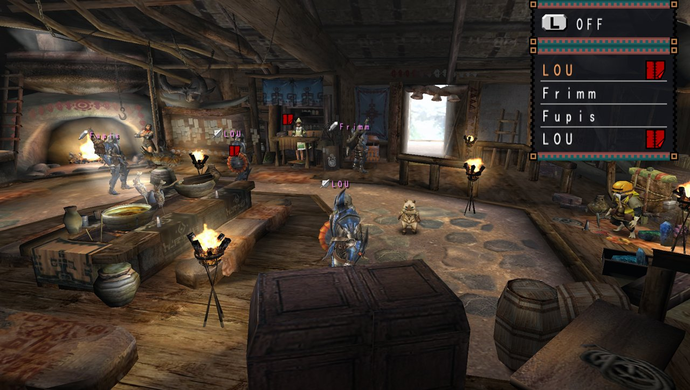
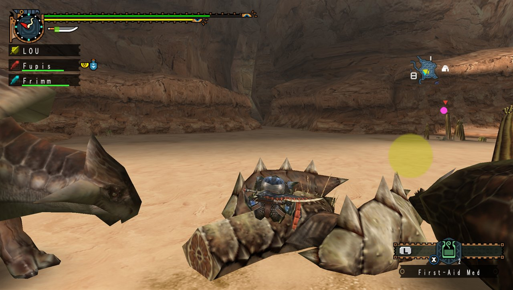
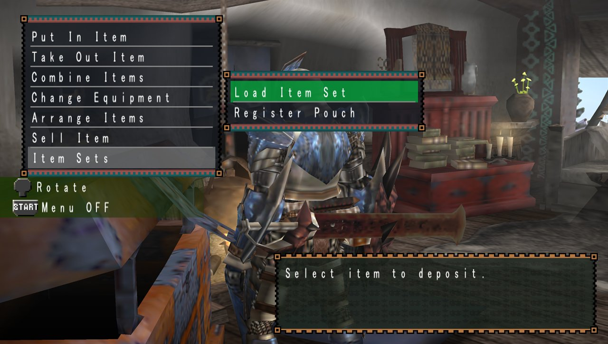
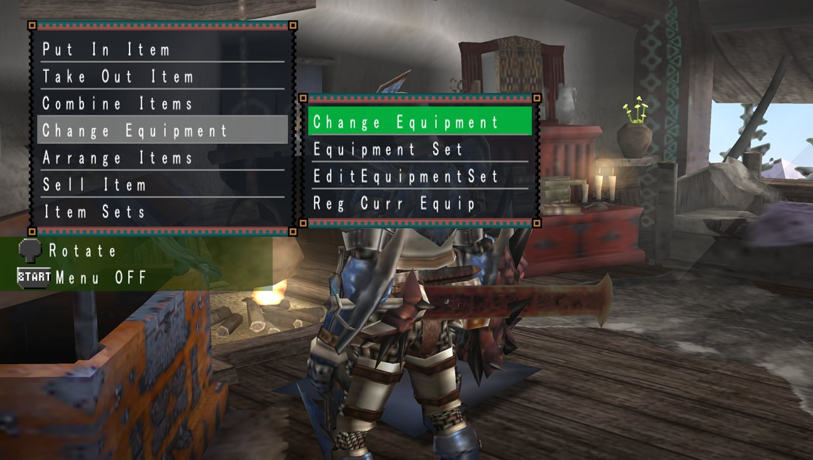
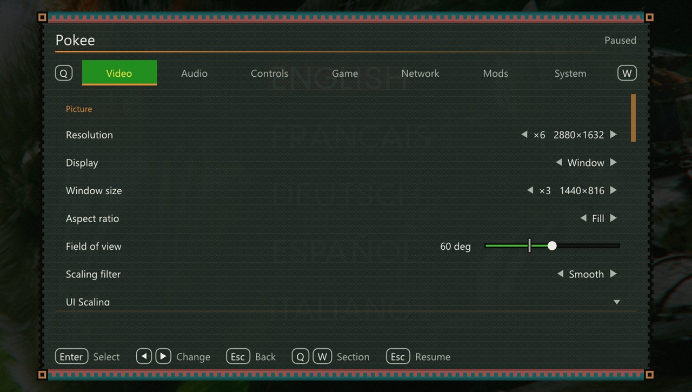
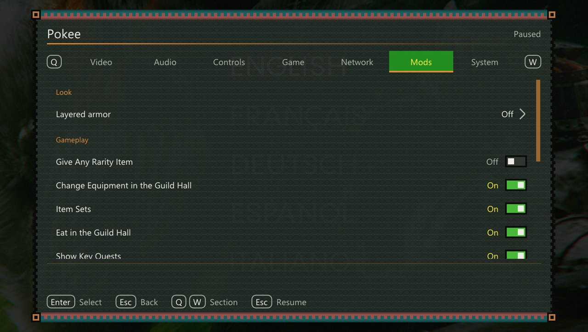

<p align="center"><a href="README.md">English</a> · <b>Русский</b> · <a href="README.es.md">Español</a></p>

<p align="center">
  <a href="https://github.com/LocalBBQ/Pokee"></a>
  <a href="https://github.com/LocalBBQ/Pokee/actions/workflows/tests.yml?query=branch%3Amain"></a>
  <a href="LICENSE"></a>
  <a href="docs/BUILDING.md"></a>
  <a href="https://github.com/LocalBBQ/Pokee/stargazers"></a>
</p>

<p align="center"></p>

<h1 align="center">Pokee</h1>

<p align="center"><b>Monster Hunter Freedom Unite, нативно на вашем ПК.</b><br>
Широкий экран, высокое разрешение, плавная частота кадров, HD-текстуры, полноценные мышь и геймпад и охота с друзьями.</p>

<p align="center">
  <a href="https://github.com/LocalBBQ/Pokee/releases/latest"><b>Скачать для Windows</b></a> ·
  <a href="docs/LINUX.md">Linux и Steam Deck</a> ·
  <a href="docs/MACOS.md">macOS</a> ·
  <a href="docs/BUILDING.md">Сборка из исходников</a>
</p>

<p align="center"></p>

> **Pokee не содержит игру.** Нужен образ диска из вашей собственной копии *Monster Hunter Freedom Unite* (США, `ULUS-10391`, версия 1.01). См. [правовую оговорку](#правовая-оговорка).

> Это перевод. Если он расходится с [английским README](README.md), правильным считается английский. Подробная документация — на английском.

## Запуск на Windows

1. **Скачайте** последний zip со [страницы релизов](https://github.com/LocalBBQ/Pokee/releases/latest).
   - `pokee-…-windows-x86_64.zip` хранит настройки и сохранения в `%APPDATA%\Pokee\MHFU`.
   - `pokee-…-windows-x86_64-portable.zip` хранит всё в папке `data` рядом с `Pokee.exe`, так что его можно держать на флешке.
2. **Распакуйте папку целиком** туда, куда можно писать, например в `C:\Games\Pokee`. Не в `Program Files`.
3. **Добавьте эту папку в исключения Защитника Windows.** При каждом запуске Pokee загружает 290 библиотек рекомпилированного кода (`overlays\*.dll`), и Защитник проверяет каждую перед загрузкой. Без исключения запуск может занимать минуты вместо секунд.
   - **Безопасность Windows** → **Защита от вирусов и угроз** → **Управление настройками** → **Исключения: Добавление или удаление исключений** → **Добавить исключение** → **Папка** → выберите папку Pokee.
   - Или в PowerShell, запущенном от имени администратора:

     ```powershell
     Add-MpPreference -ExclusionPath "C:\Games\Pokee"
     ```

   Добавляйте в исключения только папку, распакованную со страницы релизов этого репозитория.
4. **Запустите `Pokee.exe`** и выберите образ диска (`.iso`). Pokee проверит его, а затем скопирует (около 1,3 ГБ, чтобы оригинал потом можно было перенести) или будет использовать на месте. Для всей настройки достаточно одного геймпада.
5. **Играйте.** Следующие запуски сразу открывают игру. **Esc** или **L3 + R3** на геймпаде открывают меню Pokee.

Нужны 64-битная Windows и графический драйвер с поддержкой Vulkan. SDL3, FFmpeg и среда выполнения Visual C++ уже есть в zip.

Есть сохранение на PSP? [Импортируйте его](profiles/mhfu/README.md#importing-a-save-from-a-psp) и продолжайте с того же места.

## Чётче, шире, плавнее

<table>
  <tr>
    <td></td>
    <td></td>
  </tr>
</table>

Разрешение до шести раз выше, чем у PSP, картинка на весь широкий экран, более широкий угол обзора и интерполяция кадров, которая доводит 30 кадров в секунду игры до частоты вашего монитора. [HD-пакеты текстур](profiles/mhfu/README.md#hd-texture-packs), совместимые с PPSSPP, подключаются как есть; на снимках этой страницы используется один из них.

## Охота вместе

<table>
  <tr>
    <td></td>
    <td></td>
  </tr>
</table>

Зал гильдии работает так же, как на PSP: ad hoc между игроками Pokee в одной сети или через интернет с помощью ad hoc сервера. Создать сессию или присоединиться можно в разделе «Сеть» меню. [Настройка](profiles/mhfu/README.md#multiplayer-ad-hoc)

## Меньше меню, больше охоты

<table>
  <tr>
    <td></td>
    <td></td>
  </tr>
</table>

Необязательные дополнения в стиле самой игры:

- **[Наборы предметов](profiles/mhfu/README.md#item-sets)**: сохраните подсумок и загрузите его обратно одним нажатием.
- **Смена снаряжения в зале гильдии** и **[заказ еды прямо с места](profiles/mhfu/README.md#eating-in-the-guild-hall)** там же.
- **[Числа урона](profiles/mhfu/README.md#damage-numbers)** там, куда пришёлся удар, видные и другим игрокам Pokee на охоте.
- **Истинная атака** оружия, его стихии и статуса на экранах снаряжения.
- **[Значки сбора](profiles/mhfu/README.md#gather-icon)**, показывающие, что даёт точка, и **сбор удержанием**.
- **[Ключевые задания](profiles/mhfu/README.md#key-quests)** отмечены в списках заданий, и есть **[современная шкала остроты](profiles/mhfu/README.md#modern-sharpness-gauge)**.
- **[Слоистая броня](profiles/mhfu/README.md#layered-armor)**: вид одного комплекта с характеристиками другого.

## Одно меню для всего

<table>
  <tr>
    <td></td>
    <td></td>
  </tr>
</table>

Видео, звук, управление, настройки игры, сетевая игра и моды собраны в одном меню поверх игры, и любое изменение применяется сразу. Им можно пользоваться с геймпада, клавиатуры или мыши. [Все настройки](profiles/mhfu/README.md#in-game-menu)

**Управление.** На геймпаде правый стик поворачивает камеру и целится, а кнопки соответствуют подсказкам игры. Выберите пресет (Default, Modern с атаками на триггерах, Left-handed, Classic keyboard) или переназначьте что угодно, включая сочетания вроде L1 + ○. Клавиатура и мышь поддерживаются полностью: WASD для движения, мышь для камеры, её кнопки для атак. [Таблицы управления](profiles/mhfu/README.md#running)

## Статус

Игра проходится с нового персонажа или с импортированного сохранения PSP: деревня, зал гильдии и охоты, с музыкой, роликами и сохранениями в формате PSP.

| Работает | Ещё открыто |
| --- | --- |
| Вся игра: деревня, зал гильдии, охоты, музыка и ролики | Диалоги сохранения и сообщений ничего не рисуют и отвечают так, будто их подтвердили ([upstream #33](https://github.com/TeamGDB/Yakumo/issues/33)) |
| Сохранения в формате PSP и скачанные квесты; импорт, экспорт и резервные копии | Режим загрузки (`sceHttp`, `sceNetInet`) |
| Ad hoc между копиями Pokee, по локальной сети или через ad hoc сервер | Игра с PPSSPP и на публичных серверах |
| [Моды](profiles/mhfu/README.md#mods) с заменой файлов и HD-пакеты текстур | Моды кода |

Сборки для Windows — на странице релизов. Linux, Steam Deck, macOS и Android собираются из исходников; см. [LINUX.md](docs/LINUX.md), [MACOS.md](docs/MACOS.md) и [BUILDING.md](docs/BUILDING.md). Нашли проблему? [Создайте issue](https://github.com/LocalBBQ/Pokee/issues), указав платформу и что вы делали.

## Сборка из исходников

Нужны собственная копия игры, CMake 3.20+, Ninja, компилятор C++20, Python 3, SDL3, Vulkan и `glslangValidator`, а также несколько гигабайт свободной памяти. Коротко:

1. Соберите `Pokee` и запустите `Pokee --install /путь/к/образу.iso`, чтобы подготовить исполняемый файл игры из образа.
2. Сгенерируйте рекомпилированный код скриптом `profiles/mhfu/scripts/generate.sh` и соберите `Pokee`.
3. Рекомпилируйте оверлеи кода скриптом `profiles/mhfu/scripts/build_overlays.sh` (в первый раз около 40 минут; прерванная сборка продолжается с места остановки).
4. Запустите `out/mhfu/bin/Pokee`.

[docs/BUILDING.md](docs/BUILDING.md) описывает все платформы и как обойтись без полной пересборки. [CONTRIBUTING.md](CONTRIBUTING.md) объясняет, как внести вклад.

## Как это работает

Во время игры Pokee не эмулирует процессор PSP. Код игры для MIPS заранее переводится в C++ и компилируется в программу вместе с 290 оверлеями кода, которые игра подгружает по ходу работы. То, что рекомпилированный код не покрывает, исполняет интерпретатор. Вокруг этого кода — заново написанная система PSP: ядро, чтение диска, рендерер графического процессора на Vulkan, микширование звука, ввод, сохранения и ad hoc сеть.

[docs/ARCHITECTURE.md](docs/ARCHITECTURE.md) описывает модель исполнения. Pokee построен на [PSPRecomp](https://github.com/jessicanataliagta/PSPRecomp), фреймворке статической рекомпиляции, не привязанном к конкретной игре; [docs/PROFILE_GUIDE.md](docs/PROFILE_GUIDE.md) объясняет, как перенести другую игру.

## Авторы

[Pokee](https://github.com/LocalBBQ/Pokee) собран на основе [Yakumo](https://github.com/TeamGDB/Yakumo), порта Portable 3rd. Этот проект и его участники сохраняют авторство хоста, с которого начато это дерево:

- [@MHunterG](https://github.com/MHunterG)
- [@mojitosunrise](https://github.com/mojitosunrise)

## Благодарности

- [Yakumo](https://github.com/TeamGDB/Yakumo) — исходный порт и его участники
- [PSPRecomp](https://github.com/jessicanataliagta/PSPRecomp) — фреймворк рекомпиляции, на котором построен проект
- [SDL3](https://www.libsdl.org/) — окно, ввод и вывод звука
- [FFmpeg](https://ffmpeg.org/) — декодирование музыки и видео
- [Vulkan](https://www.vulkan.org/) и [MoltenVK](https://github.com/KhronosGroup/MoltenVK) — отрисовка
- [Dear ImGui](https://github.com/ocornut/imgui) — меню и экраны первоначальной настройки Pokee
- [tiny-AES-c](https://github.com/kokke/tiny-AES-c) — установщик и поддержка сохранений PSP
- [stb_truetype](https://github.com/nothings/stb) — растеризация шрифтов
- [svanheulen/mhef](https://github.com/svanheulen/mhef) — описание формата архива игры от сообщества
- [Cinzel](https://github.com/NDISCOVER/Cinzel) и [Shippori Mincho](https://github.com/fontdasu/ShipporiMincho) — шрифты логотипа, под лицензией SIL Open Font License

## Правовая оговорка

**Pokee** — независимый проект с открытым исходным кодом. Он не связан с CAPCOM, Sony или их аффилированными лицами, не уполномочен, не спонсируется и не одобрен ими.

Monster Hunter, Monster Hunter Freedom Unite, CAPCOM, PlayStation, PSP и все связанные с ними товарные знаки, игровые ресурсы, изображения, звук, персонажи и иная интеллектуальная собственность принадлежат их законным владельцам.

**Pokee** не содержит никаких ресурсов игры и оригинальных файлов игры: ни образа диска, ни копии исполняемого файла или данных игры, ни текстур, моделей, звука и видео из неё. Чтобы установить или собрать **Pokee**, нужны файлы из вашей собственной законно полученной копии Monster Hunter Freedom Unite (США); установщик проверяет эту копию и принимает только `ULUS-10391` версии 1.01.

Чтобы пользоваться **Pokee**, нужно предоставить необходимые файлы из собственной законно приобретённой копии Monster Hunter Freedom Unite (США) для PSP.

Пользователи сами несут ответственность за то, чтобы получать, снимать дамп, извлекать и использовать свою копию игры в соответствии с законами, действующими в их юрисдикции.

**Pokee** не поддерживает, не предоставляет, не ссылается на нелицензионные или пиратские копии игры и не поощряет их использование.

Любые упоминания оригинальной игры и её товарных знаков служат исключительно для идентификации, совместимости и взаимодействия.

Снимки экрана и иные изображения оригинальной игры могут использоваться только для документирования или демонстрации возможностей **Pokee**. Весь изображённый сторонний игровой контент остаётся собственностью его правообладателей.

Лицензия **Pokee** распространяется только на собственный оригинальный код и материалы проекта и не даёт никаких прав на интеллектуальную собственность третьих лиц.

**Pokee** предоставляет программу, а не игру. Законно приобретённую копию нужно предоставить самостоятельно.

## Лицензия

Репозиторий распространяется под лицензией MIT, см. [`LICENSE`](LICENSE). Лицензии сторонних файлов находятся рядом с ними, а их происхождение перечислено в [`docs/SOURCE_PROVENANCE.md`](docs/SOURCE_PROVENANCE.md).
